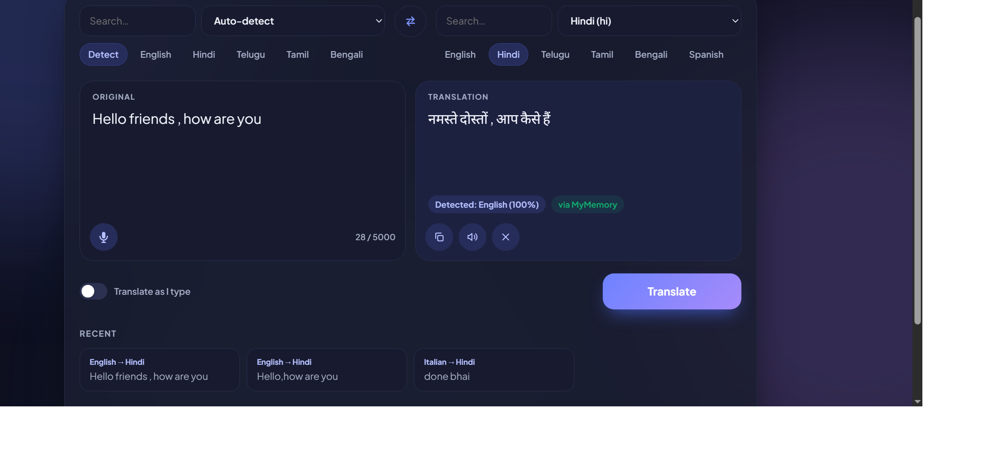

# AI Multi-Language Translator


Translate text across **299 languages** with automatic fallback between
translation engines, language detection, voice input and a built-in accuracy checker.

**Live demo:** https://ai-multi-language-translator-1ws7.onrender.com



> The demo runs on a free server, so the first request after a pause can take 30-50 seconds.

## Features
- Routes each request across Google Translate, MyMemory and (optionally) Meta NLLB-200
- Automatic fallback if one engine fails, plus English pivoting for unsupported pairs
- Language detection with `langdetect` (optional GlotLID for 1600+ languages)
- Sentence-level chunking for long text and caching for repeated requests
- BLEU score and text similarity to check translation accuracy
- Voice input, listen to the translation, history and dark mode
- Tested with pytest, CI on GitHub Actions, packaged with Docker

## Run locally
```bash
pip install -r requirements.txt
python app.py
```
Then open http://127.0.0.1:5000

## Run with Docker
```bash
docker compose up --build
```

## Run tests
```bash
pip install -r requirements-dev.txt
pytest --cov=app
```

## API
| Method | Endpoint | Body | Description |
|---|---|---|---|
| GET | `/api/languages?q=` | - | List translatable languages |
| GET | `/api/health` | - | Engine status and language count |
| POST | `/api/detect` | `{text}` | Detect language |
| POST | `/api/translate` | `{text, source, target}` | Translate text |
| POST | `/api/evaluate` | `{hypothesis, reference}` | BLEU and similarity score |

## Optional engines
```bash
pip install transformers sentencepiece torch
set NLLB_ENABLED=1       # ~200 languages, runs locally (needs 2+ GB RAM)
set GLOTLID_ENABLED=1    # detect 1600+ languages
python app.py
```
On Mac/Linux use `export` instead of `set`.

## Tech stack
Flask, deep-translator, langdetect, NLTK, pytest, Docker, GitHub Actions, Render